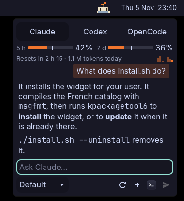

# Lumignon

A little candle for KDE Plasma 6. Ask Claude Code, Codex or OpenCode a question from the
panel, and watch it melt as your subscription quota goes.



- **The candle**: its wax is your quota. It melts as you use the quota, and its flame goes
  out when there is none left. The flame flickers at rest, dances under the mouse and
  sparkles while the agent thinks. The candle sweats past 80 %, keeps an eye on an agent
  busy in a terminal, and falls asleep after half an hour without any.
- **The popup**, on click:
  - a tab for each agent installed;
  - the agent's limit windows, each with a tick for how much of the window has gone by.
    A bar ahead of its tick means you are going faster than the pace, and a warning tells
    you when the quota would run out before the reset;
  - today's tokens, and the last 7 days;
  - the question. Enter sends it, Shift+Enter adds a line.

  The popup is as small as what it shows, and grows with the conversation.
- **Read-only**: in the widget, the agents can read files and search the web, but change
  nothing, run no command and open no web page:
  - Claude Code gets the read, file search and web search tools only, and no MCP server;
  - Codex runs in its read-only sandbox, which also cuts the network, and never asks for
    more;
  - OpenCode runs an agent of the widget's own, defined on the fly: everything is denied
    but reading, listing and searching files, and web search. Its `plan` agent would not
    do: it still runs shell commands. `.env` files stay closed.

  To go further, the terminal button, or a middle click on the candle, opens the agent on
  the same conversation, with its usual permissions.
- **Subscriptions only**: Lumignon runs the agents' own command-line tools, signed in as
  they are. It refuses to start Claude Code or Codex when they are set up with an API key.
  OpenCode runs with whatever it is configured with.

In English and French.

## Requirements

- Plasma 6 and Python 3, nothing else.
- At least one of these, installed and signed in:
  - [Claude Code](https://github.com/anthropics/claude-code), with a Claude subscription;
  - [Codex](https://github.com/openai/codex), with a ChatGPT account;
  - [OpenCode](https://opencode.ai).

  Only the installed ones get a tab.

## Install

```sh
git clone https://github.com/elomkdn/lumignon.git
cd lumignon
./install.sh
```

Then right-click a panel, *Add Widgets…*, **Lumignon**.

To update: `git pull`, `./install.sh`, then log out and back in. To remove:
`./install.sh --uninstall`. `./dist.sh` builds `dist/lumignon.plasmoid`, a file that
installs offline.

## How the usage is measured

| Agent | Limits | Tokens |
|---|---|---|
| Claude Code | The 5-hour and 7-day windows that Claude Code reports with each request | Claude Code's transcripts, in `~/.claude/projects`, cache reads excluded |
| Codex | The windows Codex records in its sessions, when your plan reports them. When a request hits the limit, the date it comes back | Codex's sessions, in `~/.codex/sessions` |
| OpenCode | None | OpenCode's database, and today's cost |

To keep Claude's windows current, Lumignon sends a minimal request to Haiku: about 700
tokens, with no session saved. It does so at most every 5 minutes, and only after Claude
Code was used on this computer, so that it never opens a new 5-hour window by itself. The
refresh button sends one on demand. What you do on other devices or on the web shows up
at the next measure.

## Privacy

Lumignon reads local files and runs the agents' tools; it sends nothing by itself. Your
questions, and the files the agent reads to answer them, go to the agent's provider, as
when you use it in a terminal. Its state lives in `~/.cache/lumignon`, readable by you
only.

An answer can carry text written by someone else, in a web page or a file the agent read.
So images in answers are never loaded: they become links. Links open only on a click, and
hovering one shows where it really goes. While the widget sends a question, the question
briefly appears in the command line of its backend, which other users of the same
computer could see.

## Limits

- It reads the JSON output of the agents' tools, and some of it is undocumented. An update
  of one of them can break the display. Tested with Claude Code 2.1.318 on a Pro plan,
  Codex 0.166.0, OpenCode 2.2.5 and Plasma 6.8.
- One question at a time.

## Translations

`po/extract.py` writes `po/template.pot` from the interface. To update a catalog:
`msgmerge --update --no-wrap po/fr.po po/template.pot`. For a new language, copy
`po/fr.po` to `po/<language>.po`, translate it, and add it to `install.sh` and `dist.sh`.

## Not affiliated

Lumignon is an independent project. It is not affiliated with, or endorsed by, Anthropic,
OpenAI or the OpenCode project. Claude, Claude Code, Codex, ChatGPT and OpenCode belong to
their respective owners.

## License

[GPL-3.0-or-later](LICENSE).
